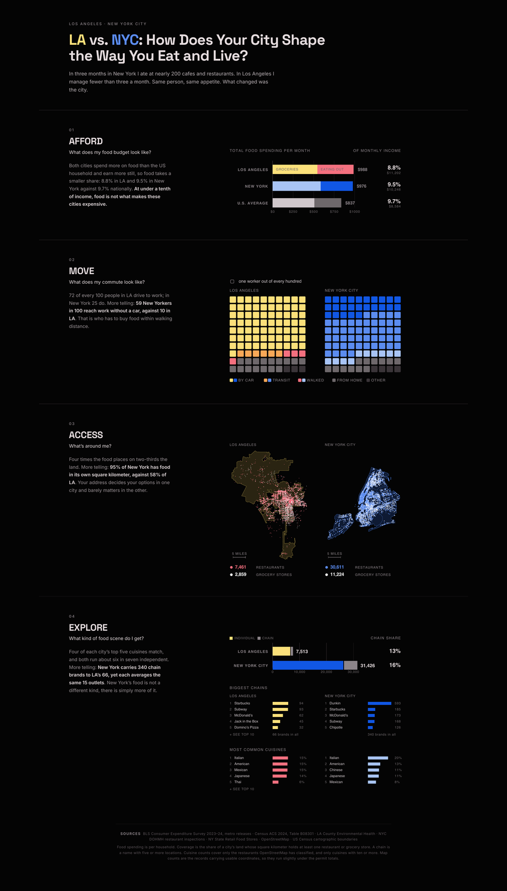

# LA vs. NYC: How Does Your City Shape the Way You Eat and Live?

In three months in New York I ate at nearly 200 cafés and restaurants. In Los Angeles I manage fewer than three a month. Same person, same appetite. What changed was the city.

An infographic in four chapters: what food costs (**Afford**), how people get to work (**Move**), what is within reach (**Access**), and what kind of food scene each city gives you (**Explore**).

**[View it](https://lemynsu.github.io/la-vs-nyc/)**

## Sources

BLS Consumer Expenditure Survey 2023 to 2024, Census ACS 2024, LA County Environmental Health, NYC DOHMH restaurant inspections, NY State Retail Food Stores, OpenStreetMap and US Census cartographic boundaries.

Designed by [Evelyn Su](https://evlynsu.com).
